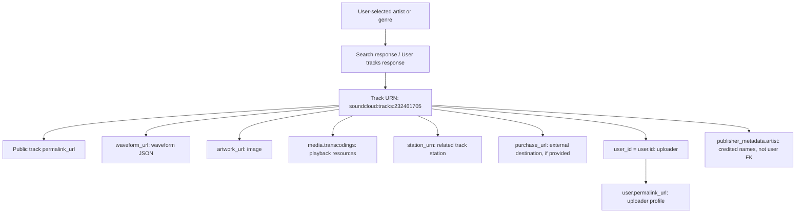

# DropDex: SoundCloud Artist & Track Metadata Integration Reference

**Prepared:** 2026-11-06  
**Audience:** DropDex product design, API integration, data modeling, and track-discovery implementation  
**Purpose:** Find and reference new SoundCloud tracks matched to a DJ's favorite artists, genres, subgenres, tags, and creator-provided download links. **No in-app audio ripping, streaming, or SoundCloud media downloading is proposed.**

> **Evidence legend**  
> **[CAPTURE]** = extracted from the supplied RTF responses and Network screenshots.  
> **[PAGE]** = extracted from `Illenium example.rtf` and matched to the highlighted SoundCloud screenshot.  
> **[OFFICIAL]** = verified with SoundCloud developer docs or Help Center on 2026-11-06.  
> **[PROPOSAL]** = suggested DropDex architecture or filtering logic, not a fact proved by the captures.

## Executive summary

- **26 distinct tracks in the supplied evidence:** 20 results from an `illenium` keyword track search, 5 tracks returned from a DVYDRM user-track collection, and 1 HXWL track page. An additional `ids` response returned **2 existing** search results (no new distinct tracks). These are snapshots, not an exhaustive SoundCloud catalog. **[CAPTURE/PAGE]**
- Every one of the **25 JSON collection tracks** has an `id` plus `urn`; the separate HXWL page uses `urn`. The URN is the preferred cross-response identity and is the basis for linking track metadata to its uploader, public URL, waveform, artwork, track stations, and external-download link. **[CAPTURE/PAGE]**
- The **search result is not necessarily uploaded by the searched-for artist**. A match for “ILLENIUM” can be an official upload, a collaborator's upload, a remix by another artist, a fan set, or a keyword/title/tag mention. Distinguish `user.id`/`user_id` (uploader identity) from credited-artist text. **[CAPTURE]**
- Across the 25 distinct collection tracks, **1** has native SoundCloud download enabled and **10** has an external `purchase_url`. The HXWL page adds another external `purchaseUrl` (with `downloadable: false`). External URLs are **advertised destinations, not proof of an accessible download file**. **[CAPTURE/PAGE]**
- SoundCloud's official API is `https://api.soundcloud.com`, authenticated with OAuth. The `api-v2.soundcloud.com` and `api-mobile.soundcloud.com` routes in captured website traffic are **website-internal response observations**, not a recommended production integration contract. **[OFFICIAL]**
- SoundCloud's API terms limit persistent storage of User Content and prohibit using the API to build a download/offline-copy feature. DropDex should link users to the source SoundCloud or creator-supplied destination and verify API access, terms, and allowed metadata retention before production. **[OFFICIAL]**

## 1. Evidence inventory and endpoint purposes

| Source | URL or endpoint observed | Returned structure | Relationship / meaning |
|---|---|---|---|
| `search endpoint 1.rtf` | `https://soundcloud.com/search?q=illenium` | HTML and initial application state; not the 20-track JSON collection | Web search entry point; may bootstrap app state. Do **not** treat page session/client IDs as durable track IDs. |
| `search enpoint track filter.rtf` | `https://api-v2.soundcloud.com/search/tracks?...&q=illenium` (identified by `next_href`) | `20 track objects` in `collection`, with `total_results`, `facets`, `next_href`, `query_urn` | Keyword track discovery. Match subsequent results using `track.urn`. |
| `search endpoint track filter with ids.rtf` | `https://api-v2.soundcloud.com/tracks?ids=232461705%2C620131050&...` (Network screenshot) | JSON array with 2 tracks | Batch record lookup for existing track IDs; both IDs appear in the search collection. |
| `search endpoint 2.rtf` | `https://api-v2.soundcloud.com/users/1469184835/tracks?...` (identified by `next_href`) | `5 objects` in `collection`, plus pagination | Tracks uploaded by the user with ID `1469184835` (DVYDRM). This owner-style representation includes extra upload metadata. |
| `Illenium example.rtf` | `https://soundcloud.com/hxwlmusic/illenium-forever-hxwl` | Next.js/React page data with a nested `Track` object | Additional HXWL track, page-oriented `camelCase` schema; matches screenshot counts, artist, length, art and icon. |

**Exact search pagination observed:**

```text
https://api-v2.soundcloud.com/search/tracks?user_id=41884-404462-28756-365958&query_urn=soundcloud%3Asearch%3A08139a7971104a52969bad2bf3badd2d&facet=genre&sc_a_id=a858d993940ad3fc1ad3fb7b8b6570cee4de8265&limit=20&offset=20&q=illenium
```

**Exact DVYDRM artist pagination observed:**

```text
https://api-v2.soundcloud.com/users/1469184835/tracks?offset=2024-11-21T03%3A48%3A23.000Z%2Ctracks%2C00000000001963289331&limit=20&representation=owner
```

- Search reports `total_results: 28,694` for the captured query. This is a search estimate/result count for that query, **not** the number of official ILLENIUM songs. The initial page of 20 is only one page. **[CAPTURE]**
- `query_urn` is a search-session/query identifier (`soundcloud:search:08139a7971104a52969bad2bf3badd2d`), **not a track ID**. `next_href` is a pagination cursor/URL, not a stable identity. **[CAPTURE]**
- The search response also exposes `facets`: genre facet values/counts and filter strings (e.g. `dubstep`, `future bass`, `trap`). Treat facet counts as dynamic and platform-defined; they are not a normalized DropDex genre taxonomy. **[CAPTURE]**
- The two Network screenshots show HTTP 200 for the search HTML and tracks-by-IDs call; an HTTP 200 does not guarantee that the same internal endpoint will be accessible from DropDex (the captured `Access-Control-Allow-Origin` is the SoundCloud website). **[CAPTURE]**

### 1.1 Official API equivalents and integration boundary

The current documented API guide confirms the following interfaces. The exact query shapes and permissions must be validated against the live **OpenAPI spec** for the registered app. **[OFFICIAL]**

| Use case | Official route/URL pattern | Important note |
|---|---|---|
| Search track catalog | `GET https://api.soundcloud.com/tracks?q=illenium&linked_partitioning=true&limit=50` | OAuth required; query parameters `q`, `genres`, `ids`, `access`, `bpm[from]`, and `duration[from]` are documented. |
| Resolve artist/track link | `GET https://api.soundcloud.com/resolve?url=https://soundcloud.com/illeniumofficial` | Returns resource representing public permalink; read actual returned URN. |
| Fetch track | `GET https://api.soundcloud.com/tracks/{track_urn}` | Prefer documented URN identifiers; exact path encoding per API docs. |
| Fetch user tracks | `GET https://api.soundcloud.com/users/{user_urn}/tracks` | Verify the user-track operation and pagination in OpenAPI for your credentials. |
| Pagination | Add `linked_partitioning=true`; follow `next_href` until absent | Do not manufacture pagination tokens. |
| Login / permissions | `https://secure.soundcloud.com` | OAuth 2.1 with PKCE for authorization-code flow; client credentials for eligible public-resource use. |
| Public track page | `track.permalink_url` | Stable user-facing handoff link; not an API endpoint. |
| Public user page | `track.user.permalink_url` | Uploader/artist profile navigation; not an API endpoint. |

**Official API reference:** https://developers.soundcloud.com/docs/api/guide.html  
**OpenAPI specification:** https://github.com/soundcloud/api/blob/master/openapi/api.yaml

## 2. Key/foreign-key map: how a track relates to everything else



| Identity/key | Concrete captured value | Connects to | Exact URL, URL rule, or caveat |
|---|---|---|---|
| Track numeric `id` | `232461705` | `urn`, `publisher_metadata.id`, IDs lookup parameter | Exact track in `GET /tracks?ids=232461705,620131050` (captured internal route). Use URN as primary canonical ID in DropDex. |
| Track `urn` | `soundcloud:tracks:232461705` | Track object across collections, media paths, station naming | Encoded within `uri` and `media.transcodings[*].url`. |
| Track `uri` | `https://api.soundcloud.com/tracks/soundcloud%3Atracks%3A232461705` | API identity link | API-form URL reported in captured JSON, **not a file URL**. |
| Track `permalink_url` | https://soundcloud.com/illeniumofficial/niykee-heaton-infinity-illenium-remix-1 | User-facing track details | **Primary track click-through URL**. |
| `permalink` | `niykee-heaton-infinity-illenium-remix-1` | Slug component of track permalink | Cannot by itself identify the uploader. Prefer complete permalink URL. |
| `user_id` | `27111815` | `user.id`, uploader | Same uploader on all official ILLENIUM account tracks in the sample. |
| `user.urn` | `soundcloud:users:27111815` | Uploader identity | Official APIs accept URN-based identifiers in supported paths. |
| `user.permalink_url` | https://soundcloud.com/illeniumofficial | Public uploader/artist profile | **Primary user click-through URL**. |
| `publisher_metadata.id` | `232461705` | Same track ID | Not an artist identifier. |
| `publisher_metadata.artist` | `ILLENIUM, HAYLA, Wooli` (Wooli remix) | Credited artist/collaborators | Human-readable **text**, not verified relations to individual SoundCloud accounts. |
| `artwork_url` | https://i1.sndcdn.com/artworks-000139142922-q77sa2-large.jpg | Track cover art | Image URL; no durable reference to track in its filename. |
| `waveform_url` | https://wave.sndcdn.com/1NaUFrrJ58MF_m.json | Track waveform | JSON waveform data, not downloadable audio. |
| `station_urn` | `soundcloud:system-playlists:track-stations:232461705` | Related station/system-playlist | Can identify a station, but not proof of artist relation or a new upload. |
| `media.transcodings[0].url` | https://api-v2.soundcloud.com/media/soundcloud:tracks:232461705/a20c6686-0f34-4c2f-91e8-48e372001fae/stream/hls | Audio playback variant | **Not** a source-file download link; streaming access may be restricted. No player feature proposed. |
| `purchase_url` | `https://www.hive.co/downloads/download/419475/spotlight` | Artist-supplied external destination | Link label and destination must be evaluated separately; may lead to purchase, streaming, or authorized download. |
| `next_href` | See actual URLs in Section 1 | Next collection page | Cursor state, **not** an identity key. |
| Search `query_urn` | `soundcloud:search:08139a7971104a52969bad2bf3badd2d` | Query context/pagination | Never use as track key. |

**[PROPOSAL] Canonical keys:**

```text
artist_key  = user.urn or "soundcloud:users:" + user.id
track_key   = track.urn or "soundcloud:tracks:" + track.id
uploader_fk = track.user.urn or "soundcloud:users:" + track.user_id
click_url   = track.permalink_url           # never construct from title
artist_url  = track.user.permalink_url      # actual uploader profile
```

**Use the SoundCloud-provided URLs as-is when available.** Do not assume a title-to-slug transformation will recreate the canonical URL; public permalinks may change.

## 3. Track metadata dictionary: keys, example values, and URL relationships

The paths below describe the **captured website JSON**, not necessarily the names used by the supported public API. `—` means the field itself is not a URL. Links are **examples from these captures**, not newly fetched or guaranteed-live downloads.

### 3.1 Track identity, title, genre, and description

| Field/tag | Actual example | Link / key relationship | Recommended DropDex use |
|---|---|---|---|
| `id` | `2122592712` | `urn=soundcloud:tracks:2122592712` | Numeric alternate ID; avoid duplicates. |
| `urn` | `soundcloud:tracks:2122592712` | Underlies `uri`, `station_urn`, media URL paths | Canonical external track key. |
| `uri` | `https://api.soundcloud.com/tracks/soundcloud%3Atracks%3A2122592712` | Track API resource | Reference only, not playback/download. |
| `permalink` | `in-my-arms-wooli-remix` | Component of `permalink_url` | URL display/debugging. |
| `permalink_url` | https://soundcloud.com/illeniumofficial/in-my-arms-wooli-remix | Public track page | Open SoundCloud from DropDex. |
| `title` | `In My Arms (Wooli Remix)` | Text; no direct key | Visible title and keyword search. |
| `kind` | `track` | — | Confirm object type before parsing. |
| `description` | Movement states `FREE DL: https://hypeddit.com/dvydrm/crankdatmovementdvydrmflip` | May contain creator-written external URLs | Keyword/reference extraction; **not** authoritative download rights. |
| `genre` | `Dubstep`, `Dance`, `Dance & EDM`, `Electronic`, `Melodic` | — | Normalize to your curated genre taxonomy. |
| `tag_list` | `flume illenium "tove lo" Remix "future bass" Melodic "melodic dubstep" ...` | String containing free-text tags; quoted phrases | Parse correctly; preserve original and normalized tokens. |
| `caption` | `null` in captures | — | Optional display text; do not rely on it. |
| `label_name` | `Illenium, LLC`; `Melodious Sky` | — | Label display/filter where present. |
| `public` / `sharing` | `true` / `public` | Public page may exist | Visibility; follow API permissions and state. |
| `state` | `finished` | — | Exclude unfinished/unavailable items in discovery. |
| `last_modified` | `2025-07-08T02:08:17Z` | — | Metadata change detection, not necessarily new music. |

### 3.2 Artist and uploader fields

| Field/tag | Actual example | Link / key relationship | DropDex use |
|---|---|---|---|
| `user_id` | `27111815` | `user.id` and `soundcloud:users:27111815` | **Exact uploader match**. |
| `user.id` | `27111815` | Equals `user_id` | Join track -> user. |
| `user.urn` | `soundcloud:users:27111815` | API user identifier | Preferred uploader key. |
| `user.username` | `ILLENIUM` | Profile URL: https://soundcloud.com/illeniumofficial | Display and secondary text match. |
| `user.full_name` | `Nicholas Miller` | No standalone artist profile key | Optional uploader display name. |
| `user.first_name`, `user.last_name` | `Nicholas`, `Miller` | — | Profile metadata only. |
| `user.permalink` | `illeniumofficial` | Part of `user.permalink_url` | Profile slug. |
| `user.permalink_url` | https://soundcloud.com/illeniumofficial | User web page | Open artist profile. |
| `user.uri` | `https://api.soundcloud.com/users/soundcloud%3Ausers%3A27111815` | API identity URL | Reference if returned. |
| `user.avatar_url` | `https://i1.sndcdn.com/avatars-YEUnFxgzbTDaYpCu-1XevYg-large.jpg` | Profile image, not artwork | Artist-list avatar (subject to permitted use). |
| `user.verified` | `true` on ILLENIUM; `false` on HXWL | — | Trust signal only; not evidence that a specific remix is authorized. |
| `user.followers_count` | `613076` in sample | — | Optional ranking, stale snapshot. |
| `user.track_count` | `267` in ILLENIUM expanded user object | — | Account stats, not results collected. |
| `user.city`, `user.country_code` | `Denver`, `null` (ILLENIUM) | — | Optional metadata, no artist-match requirement. |
| `publisher_metadata.artist` | `ILLENIUM, HAYLA, Wooli` | **No artist ID foreign key in this capture** | Credited performers/collaborators. |
| `publisher_metadata.isrc` | `USUG12505400` | External recording identifier; not a SoundCloud URL | Cross-platform recording matching where provided. |

**Artist identity example: a search for ILLENIUM returned uploads by ILLENIUM, WHALES, Subtronics, LUMINATE, and other users.** If a favorite artist is specifically the official ILLENIUM account, require `user_id=27111815` for strict uploader matching. For remixes/features uploaded elsewhere, use a separate *credited artist or text mention* rule and label the match confidence appropriately. **[CAPTURE/PROPOSAL]**

### 3.3 Release, identifiers, rights, and engagement

| Field/tag | Actual example | URL relation | DropDex significance |
|---|---|---|---|
| `created_at` | `2025-07-01T12:33:48Z` | — | Upload/creation timeline. |
| `display_date` | `2025-07-04T00:00:00Z` | — | Date presented by SoundCloud; may differ from creation. |
| `release_date` | `2025-07-04T00:00:00Z` | — | Explicit release date; can be null. |
| `last_modified` | `2025-07-08T02:08:17Z` | — | Updated metadata date; **not** proof of a newly published track. |
| `publisher_metadata.album_title` | `In My Arms` | — | Album matching. |
| `publisher_metadata.release_title` | `In My Arms (Wooli Remix)` | — | Release/edition display. |
| `publisher_metadata.upc_or_ean` | `00602478673337` | External release identifier | Catalog matching, preserve leading zeros. |
| `publisher_metadata.explicit` | `false` | — | Explicit-content filtering. |
| `publisher_metadata.contains_music` | `true` | — | Media classification, when present. |
| `publisher_metadata.p_line`, `c_line` | Label/copyright text | — | Rights display, not automated licensing clearance. |
| `publisher_metadata.iswc`, `writer_composer`, `publisher` | Sometimes blank | — | Optional songwriter/publisher data. |
| `license` | `all-rights-reserved` | — | Rights status, not a download grant. |
| `likes_count` | `10876` on Wooli remix | — | Ranking metric only. |
| `playback_count` | `330389` on Wooli remix | — | Popularity, stale snapshot. |
| `comment_count`, `reposts_count` | `151`, `283` on Wooli remix | — | Engagement. |
| `commentable`, `reveal_comments`, `reveal_stats` | Boolean flags | — | Comment/stat visibility; some fields owner-only. |
| `monetization_model`, `policy` | `AD_SUPPORTED`, `MONETIZE` (Wooli remix) | — | Monetization/access context, **not** download permission. |

### 3.4 Track playback/media and uploaded-file metadata (for identification, not file retrieval)

| Field | Captured example | URL / relation | Interpretation |
|---|---|---|---|
| `duration` | `195356` | — | Milliseconds. |
| `full_duration` | `195344` | — | Full duration in milliseconds, may differ slightly. |
| `streamable` | `true` | — | Website says track is streamable; not a legal-download flag. |
| `api_streamable` | `true` (DVYDRM collection) | — | Additional owner-style availability indicator. |
| `media.transcodings[*].url` | `https://api-v2.soundcloud.com/media/soundcloud:tracks:2122592712/.../stream/cbc-encrypted-hls` | Track URN embedded in resource URL | Media/transcoding resource, **not** a direct downloadable source file. |
| `media.transcodings[*].preset` | `aac_160k`, `aac_96k`, `abr_sq` | — | Playback variant selection, not original upload codec. |
| `media.transcodings[*].format.protocol` | `hls`, `cbc-encrypted-hls`, `ctr-encrypted-hls`, `progressive` | — | Playback transport, some tracks encrypted. |
| `media.transcodings[*].format.mime_type` | `audio/mp4; codecs="mp4a.40.2"` | — | MIME type for stream format. |
| `media.transcodings[*].quality` | `sq`, `lq` | — | Playback quality tier. |
| `waveform_url` | https://wave.sndcdn.com/2wiyVMAsI27d_m.json | Waveform JSON URL | Optional remote visualization only, not audio. |
| `visuals` | Usually `null` for tracks; expanded user may have visuals | Image URL if present | Optional media property. |
| `upload.container` | `wav` | — | **Original** uploaded-file format, present in DVYDRM owner tracks only. |
| `upload.codec` | `pcm_s16le` for Movement; `pcm_s24le` for Parachute | — | Source PCM encoding, not SoundCloud stream codec. |
| `upload.bit_rate` | `1411200` for Movement; `2116800` for Parachute | — | Source bit rate, bits per second. |
| `upload.sample_rate` | `44100` | — | Source sample rate, Hz. |
| `snippet_presets` | Movement: `107` to `127` seconds | — | Chosen snippet range, **not** an automatically analyzed chorus/drop. |
| `track_authorization` | Token in response (excluded from this guide) | Temporary authorization data | **Do not save or log tokens.** |

**BPM/key nuance:** The provided JSON track examples do **not** include dedicated `bpm` or `key_signature` values. The official OpenAPI schema does describe these attributes and BPM-based filters, but that does **not** establish that they are populated for these captured tracks. Treat their presence/accuracy as optional; do not infer track BPM/key from tags or an HLS preset. **[CAPTURE/OFFICIAL]**

## 4. Download discovery: native file vs. external creator link

### 4.1 Both dimensions must be stored separately

| Metadata state | Interpretation | DropDex action |
|---|---|---|
| `downloadable: true` and downloads still available | Uploader permits SoundCloud native file download | Show **Open in SoundCloud**; SoundCloud handles sign-in/authorization/file transfer. |
| `purchase_url` non-null and `purchase_title` contains `Free Download`, `FREE DL`, etc. | Uploader advertises an **external** download landing page | Show **Creator download link**. Do not imply verified file or authorization beyond landing page. |
| `purchase_url` non-null with `Spotify`, `Buy/Stream`, `Download`, or null title | External commercial/promo/link hub | Show **External link** and label as unknown purchase/download status until checked. |
| `downloadable: false` and `purchase_url: null` | No download path identified in these fields | Show **No download link detected**, not “download impossible.” |
| Both present | Both kinds of action possible | Present both distinctly; do not merge. |

A SoundCloud *cart icon* under the waveform is the creator's custom **Buy link** (which can be labeled Free Download), and is **different** from the native Download File button. [SoundCloud Help Center: Buy link](https://help.soundcloud.com/hc/en-us/articles/115003563068-Edit-the-Buy-link-and-Artist-Storefront-on-a-track). **[OFFICIAL]**

### 4.2 Exact HXWL remix cross-reference [PAGE]

| Field | Captured value |
|---|---|
| `urn` | `soundcloud:tracks:2369914733` |
| `title` | `ILLENIUM - Forever (HXWL Remix)` |
| `artist` | `HXWL, ILLENIUM` |
| `user.username` / `user.urn` | `HXWL` / `soundcloud:users:1365138297` |
| `genre` / `userTags` | `Dubstep` / `illenium, Melodic, Bass, Edm, sad` |
| `fullDuration` | `203200 ms` = 3:23 |
| `counts.plays`, `counts.comments` | `8605` / `112` (exact screenshot match) |
| `downloadable` / `downloadsRemaining` | `false` / `0` |
| `purchaseTitle` | `Free Download` |
| `purchaseUrl` | https://gate.sc?url=https://droploud.com/track/e5051e1c-e169-4a9d-a1f8-d49044c6b55a |
| External destination inside URL | https://droploud.com/track/e5051e1c-e169-4a9d-a1f8-d49044c6b55a |
| `permalinkUrl` | https://soundcloud.com/hxwlmusic/illenium-forever-hxwl |
| `artworkUrl` | https://i1.sndcdn.com/artworks-0MyZtaatyvnLW3Mt-eYJLpg-original.jpg |
| `waveformUrl` | https://wave.sndcdn.com/5i4dT2HlEdl4_m.json |
| `mediaUpload` | WAV / `pcm_s24le` / stereo / 44,100 Hz / 2,116,800 bit/s |

**Conclusion:** The yellow-highlighted icon is the **external link action**, not SoundCloud-native downloads. It is consistent with `purchaseTitle="Free Download"` despite `downloadable=false`. The page file does **not** confirm that the destination is live, free after any gate, or directly yields a file. **[PAGE/OFFICIAL]**

### 4.3 Other concrete download-related examples

| Track | Native enabled? | External label | External URL / observation |
|---|---|---|---|
| DVYDRM - Hero ft. Trevor Laake | **Yes** (`has_downloads_left: true`) | None | https://soundcloud.com/dvydrm-153971341/dvydrm-hero-ft-trevor-laake (native-download landing page) |
| Crankdat - Movement (DVYDRM Flip) | No | Free Download | https://hypeddit.com/dvydrm/crankdatmovementdvydrmflip |
| Niykee Heaton - Infinity (Illenium Remix) | No | Free Download | https://www.hive.co/downloads/download/419475/spotlight |
| Good Things Fall Apart | No | Download | https://illenium.lnk.to/GoodThingsFallApart |
| Got Away (WHALES Remix) | No | FREE DL | https://laylo.com/whalesfm/lzkmjm |
| Close My Eyes (LUMINATE Remix) | No | Free Download | https://droploud.com/track/ca691bc4-6e73-42e7-973a-3b22905153b9 |
| Forever (HXWL Remix) | No | Free Download | https://gate.sc?url=https://droploud.com/track/e5051e1c-e169-4a9d-a1f8-d49044c6b55a |

**No actual direct download-file URL is present for these examples.** A permitted file transfer, if any, belongs on SoundCloud's native download flow or the creator's external destination. **[CAPTURE/PAGE]**

## 5. Artist and genre discovery design for DropDex [PROPOSAL]

### 5.1 Suggested user-configurable criteria

| Preference/filter | Source fields | How to match | Caveat |
|---|---|---|---|
| Favorite **official account** | `user.urn`, `user_id`, `user.permalink_url` | Resolve a user URL once and use exact account key | Only uploads from that account. |
| Favorite **credited artist** | `publisher_metadata.artist`, page `artist`, `title`, selected metadata | Normalize artist names, track feature/remix tags, show confidence | Not a reliable foreign-key relationship; don't claim official association. |
| Favorite genre | `genre` | Exact normalized genre alias group | Single creator-defined label may be broad/inaccurate. |
| Favorite subgenre | `tag_list`, page `userTags`, `genre`, title/description | Exact phrase/alias match for terms such as `melodic dubstep`, `hybrid trap`, `future bass` | Free-text tags can be spammy; use evidence tiers. |
| Genre exclusions | Same | Exclude verified disallowed labels | Avoid accidentally excluding features. |
| New since | `created_at`, `display_date`, `release_date` + first-observed time | Evaluate both upload-new and release-new separately | Editing an old track doesn't make it a new upload. |
| Remixes/edits/flips | `title`, `tag_list`, description | Word-boundary match on `remix`, `flip`, `edit`, `bootleg` | A remix is not automatically authorized for redistribution. |
| Prefer download links | `downloadable`, `has_downloads_left`, `purchase_title`, `purchase_url` | Separate native vs. external classifications | External link advertised ≠ verified download. |
| Minimum duration | `duration`, `full_duration` | Milliseconds; e.g. >= 90,000 ms | Doesn't distinguish teaser from full set by itself. |
| Exclude sets/clips | `title`, `duration`, creator-defined tags | User preference, heuristics (`full set`, `clip`) | Not a SoundCloud guaranteed media type. |
| Popularity threshold | `likes_count`, `playback_count`, `reposts_count` | Optional rank, not admission rule by default | Older tracks accumulate more engagements. |

### 5.2 Example rule set

```yaml
# PROPOSAL ONLY: DropDex user-defined discovery rule
rule_id: illenium-melodic-bass-new-releases
artists:
  official_uploader_urns:
    - soundcloud:users:27111815
  credited_names: [ILLENIUM]     # broader, lower-confidence matches
  include_other_uploaders: true
music:
  allowed_genres: [Dubstep, Dance & EDM, Melodic, Electronic]
  preferred_tags: ["melodic dubstep", "melodic bass", "future bass", "hybrid trap"]
  exclude_title_terms: ["full set", "clip"]
discovery:
  freshness_days: 30
  use_created_at: true
  use_release_date_when_present: true
  require_unique_track_urn: true
links:
  show_native_download: true
  show_external_download_landing: true
  show_other_external_links: false
  never_fetch_audio: true
```

### 5.3 Candidate ranking with transparent evidence

1. **Exact uploader match**: `track.user.urn` equals a saved favorite SoundCloud user URN. High confidence that the track came from that account; **not** confirmation it is a new release or was cleared by a rights holder.
2. **Credited-artist match**: exact normalized name match in structured artist credits, when available. Strong evidence of a credit, weaker evidence of official upload; retain uploader separately.
3. **Track-title association**: a favorite artist name is in a track title (`ILLENIUM Remix`, for example). Treat as an association, not proof of authorized release.
4. **Genre match**: normalized `genre` aligns with user's preferences.
5. **Tag/subgenre match**: phrase-normalized `tag_list` or `userTags` contains user-preferred tags. Ensure quoted multiword tags stay together.
6. **Freshness and download relevance**: rank recent and download-link-advertising tracks; do not conflate engagement counts with quality or legitimacy.
7. **Warnings and provenance**: show `Uploader`, `Credited artist`, and `Why matched` so the user can interpret results.

Sample **two distinct discovery cards** from same favorite-artist query:

- `In My Arms (Wooli Remix)` → uploader: `ILLENIUM` (exact account `soundcloud:users:27111815`), credited artists: `ILLENIUM, HAYLA, Wooli`, genre `Dance`, URL https://soundcloud.com/illeniumofficial/in-my-arms-wooli-remix.
- `Got Away (WHALES Remix)` → uploader: `WHALES`, title/credits include Illenium-associated wording, genre `Dubstep`, external Free DL link https://laylo.com/whalesfm/lzkmjm. **Do not label this as uploaded by ILLENIUM.**

### 5.4 New-track detection and pagination

**[PROPOSAL]** For each saved favorite artist or genre query:

1. Resolve official artist account URL to an immutable user URN if user means **their SoundCloud account**. Store user-selected preferences and authorized minimal references only; don't use mutable display names as primary keys.
2. Request the documented official API resource, with proper OAuth and linked pagination. Read the collection and follow returned `next_href` until exhausted or a safe configured lookback/limit is reached.
3. Validate object `kind`, visibility, URI/URN identity, and availability. Deduplicate using `track.urn` across artist feed and genre/keyword searches.
4. Compare to **previously observed URNs** using a storage approach approved under SoundCloud's terms. A previously unseen URN is a **new discovery to DropDex**, not necessarily a newly uploaded song. Use `created_at` and `release_date` for separate freshness signals.
5. Attribute the match, classify link availability, and present the public SoundCloud permalink or exact creator-provided external URL. If a track becomes unavailable/removed, stop presenting stale data promptly.
6. Treat new tags, descriptions, or changed `last_modified` as **metadata updates**, not new tracks.

**Avoid these common errors:** `id`/`urn` mismatch, display name collisions, duplicate results from overlapping queries, conflating `release_date` with `created_at`, relying on a single page of 20 results, and treating `query_urn` or a media-transcoding UUID as a track key.

## 6. Normalization rules and data shape [PROPOSAL]

### 6.1 CamelCase mapping: `Illenium example.rtf` vs prior API JSON

| Earlier field | New track-page field | Notes |
|---|---|---|
| `urn` | `urn` | Exact track identity. |
| `title` | `title` | Same semantic field. |
| `user.username` | `user.username` | Uploader handle. |
| `user.urn` | `user.urn` | Uploader identity. |
| `publisher_metadata.artist` | `artist` | Both convey credited text but may differ in presence/format. |
| `genre` | `genre` | Value may be uploader-defined. |
| `tag_list` | `userTags` | String with quoted words vs. array of strings; preserve original labels. |
| `purchase_url` | `purchaseUrl` | External action URL. |
| `purchase_title` | `purchaseTitle` | Custom action label. |
| `downloadable` | `downloadable` | Native download flag. |
| `has_downloads_left` | `downloadsRemaining` | **Boolean vs numeric**: not identical raw types. |
| `permalink_url` | `permalinkUrl` | Public track URL. |
| `artwork_url` | `artworkUrl` | Cover art. |
| `waveform_url` | `waveformUrl` | Visualization JSON. |
| `full_duration` | `fullDuration` | Milliseconds. |
| `created_at` | `createdAt` | Date parse differs (`ISO 8601` vs formatted date). |
| `display_date` / `release_date` | `publishedAt` / `releaseDate` | Related but **not guaranteed identical** semantics. Preserve original separately. |
| `likes_count`, `playback_count`, `comment_count`, `reposts_count` | `counts.likes`, `.plays`, `.comments`, `.reposts` | Engagement. |
| `upload.codec`, `.container`, `.sample_rate`, `.bit_rate` | `mediaUpload.codec`, `.container`, `.sampleRate`, `.bitRate` | Original-file metadata if surfaced. |
| `media.transcodings` | `transcodings` | Playback metadata; no in-app audio retrieval needed. |
| `station_urn` | `stationPermalinkSlug` | Related station references, **not** exact same string representation. |

### 6.2 Suggested normalized record (illustrative, NOT an API response)

```json
{
  "provider": "soundcloud",
  "track_urn": "soundcloud:tracks:2369914733",
  "track_id": "2369914733",
  "title": "ILLENIUM - Forever (HXWL Remix)",
  "track_url": "https://soundcloud.com/hxwlmusic/illenium-forever-hxwl",
  "uploader_urn": "soundcloud:users:1365138297",
  "uploader_username": "HXWL",
  "uploader_url": "https://soundcloud.com/hxwlmusic",
  "artist_credit_text": "HXWL, ILLENIUM",
  "genre_raw": "Dubstep",
  "genres_normalized": ["dubstep"],
  "tags_raw": ["illenium", "Melodic", "Bass", "Edm", "sad"],
  "duration_ms": 203200,
  "native_download_enabled": false,
  "native_downloads_remaining": 0,
  "external_action_title": "Free Download",
  "external_action_url": "https://gate.sc?url=https://droploud.com/track/e5051e1c-e169-4a9d-a1f8-d49044c6b55a",
  "external_link_verified": false,
  "matched_rules": ["credited-name:ILLENIUM", "genre:dubstep"],
  "data_provenance": "page-response-capture",
  "availability_last_checked": null
}
```

**Storage warning:** This illustrates *data transformation*. It does **not** grant permission to persist this track object; see Section 8. Keep policy-compliant ephemeral metadata handling and app-owned user preference storage separate from unauthorized persistent SoundCloud User Content storage.

### 6.3 Parsing tag values

The capture has two formats:

```text
# Legacy-style track collection (space-separated, quoted multiword tags)
tag_list = 'flume illenium "tove lo" Remix "say it" "future bass" Melodic "melodic dubstep"'

# New track page (already an array)
userTags = ["illenium", "Melodic", "Bass", "Edm", "sad"]
```

**Implementation guidance:** tokenize `tag_list` with a parser that respects quoted phrases; Unicode normalize, case-fold, trim spaces and map approved aliases. Preserve original tags for display and record why a track matched. Do not split `"melodic dubstep"` into separate independent tags. SoundCloud's published OpenAPI also describes **machine tags** (`NAMESPACE:KEY=VALUE`), so don't indiscriminately discard punctuation in unknown tags. **[CAPTURE/OFFICIAL]**

### 6.4 Minimal proposed DropDex-owned preference schema

```sql
-- App-owned discovery preferences only. This does not store audio or
-- full third-party SoundCloud user-content objects.
CREATE TABLE soundcloud_discovery_preferences (
  rule_id TEXT PRIMARY KEY,
  favorite_uploader_urn TEXT,  -- e.g., soundcloud:users:27111815
  credited_artist_query TEXT,
  genre_filters_json TEXT,     -- app-defined preference list
  tag_filters_json TEXT,       -- app-defined preference list
  search_lookback_days INTEGER DEFAULT 30,
  include_external_links BOOLEAN DEFAULT TRUE,
  include_native_download_links BOOLEAN DEFAULT TRUE,
  enabled BOOLEAN DEFAULT TRUE
);
```

Before building any persistent `soundcloud_tracks` cache, obtain permission/review retention rules. In particular, SoundCloud's API terms bar persistent storage of User Content and limit session-based caching. App-owned preference configuration is distinct from copying the content itself, but even identifier retention should be reviewed for the intended use. [SoundCloud API Terms](https://developers.soundcloud.com/docs/api/terms-of-use).

## 7. Real track catalog from captured JSON (all distinct collection records)

The tables below are **snapshot values**, not live availability checks. Dates are `created_at` UTC; original artist/uploader capitalization is preserved. The rows are all source-backed and deduplicated by `id`.

### 7.1 ILLENIUM keyword-search results (20)

| Track ID | Title | Uploader | Credited artist(s) if present | Genre | Created UTC | Download signal | Track URL |
|---|---|---|---|---|---|---|---|
| `2122592712` | In My Arms (Wooli Remix) | ILLENIUM | ILLENIUM, HAYLA, Wooli | Dance | 2025-07-01 | No download link | [Open](https://soundcloud.com/illeniumofficial/in-my-arms-wooli-remix) |
| `281670564` | Flume - Say It ft. Tove Lo (Illenium Remix) | ILLENIUM | — | Dance & EDM | 2016-09-06 | External link | [Open](https://soundcloud.com/illeniumofficial/flume-say-it-ft-tove-lo-illenium-remix) |
| `250711755` | The Chainsmokers - Don't Let Me Down (Illenium Remix) | ILLENIUM | — | Dance & EDM | 2016-03-07 | External link | [Open](https://soundcloud.com/illeniumofficial/the-chainsmokers-dont-let-me-down-illenium-remix) |
| `790323115` | ILLENIUM & Excision - Feel Something ft. I Prevail | ILLENIUM | ILLENIUM | Dance & EDM | 2020-04-03 | External link | [Open](https://soundcloud.com/illeniumofficial/illenium-excision-feel-something-ft-i-prevail) |
| `2403938235` | ILLENIUM - Lost Lands 2026 (Full Set) | Johnnykham | ILLENIUM | Dubstep | 2026-09-20 | No download link | [Open](https://soundcloud.com/johnnykham-745185291/illenium-lost-lands-2026) |
| `221054822` | Kaskade ft. Ilsey - Disarm You (Illenium Remix) | ILLENIUM | — | Melodic | 2015-08-26 | No download link | [Open](https://soundcloud.com/illeniumofficial/kaskade-disarm-you-illenium-remix-1) |
| `2224837376` | SUBTRONICS & ILLENIUM - GOT AWAY (WHALES REMIX) | WHALES | WHALES | Dubstep | 2025-12-06 | External link | [Open](https://soundcloud.com/whalesfm/got-away-remix) |
| `232461705` | Niykee Heaton - Infinity (Illenium Remix) | ILLENIUM | — | Melodic | 2015-11-10 | External link | [Open](https://soundcloud.com/illeniumofficial/niykee-heaton-infinity-illenium-remix-1) |
| `2337861662` | Don't Want Your Love (RØZ Remix) [feat. Ellie Goulding] | ILLENIUM | ILLENIUM | Dance | 2026-06-12 | No download link | [Open](https://soundcloud.com/illeniumofficial/dont-want-your-love-roz-remix) |
| `620131050` | ILLENIUM - Good Things Fall Apart (With Jon Bellion) | ILLENIUM | ILLENIUM | Electronic | 2019-05-13 | External link | [Open](https://soundcloud.com/illeniumofficial/illenium-good-things-fall-apart-with-jon-bellion) |
| `204387216` | Galantis - Gold Dust (Illenium Remix) | ILLENIUM | — | Dubstep | 2015-05-07 | No download link | [Open](https://soundcloud.com/illeniumofficial/galantis-gold-dust-illenium-remix-1) |
| `2356233953` | Feel Something (AlienPark Remix) [feat. I Prevail] | ILLENIUM | ILLENIUM, Excision, AlienPark | Dance | 2026-07-09 | No download link | [Open](https://soundcloud.com/illeniumofficial/feel-something-alienpark-remix) |
| `2261151905` | I'll Come Runnin | ILLENIUM | ILLENIUM, Zeds Dead, Mako | Dance & EDM | 2026-02-06 | No download link | [Open](https://soundcloud.com/illeniumofficial/ill-come-runnin-1) |
| `2410321653` | ILLENIUM & Ray Volpe - ID (Forever Mine) [clip] | Jimbo | ILLENIUM, Ray Volpe | Dubstep | 2026-09-30 | No download link | [Open](https://soundcloud.com/jimbojames69/illenium-ray-volpe-id-forever) |
| `2427187452` | Marshmello & ILLENIUM (Feat. SACHA) - Close My Eyes (LUMINATE Remix) | LUMINATE �� | Marshmello, ILLENIUM, LUMINATE | Dubstep | 2026-10-27 | External link | [Open](https://soundcloud.com/iamluminate/marshmello-illenium-with-sacha) |
| `336866011` | Illenium - Crawl Outta Love (ft. Annika Wells) | ILLENIUM | Illenium, Annika Wells | Dance & EDM | 2017-08-07 | External link | [Open](https://soundcloud.com/illeniumofficial/illenium-crawl-outta-love-ft-annika-wells-1) |
| `2015144835` | Self Titled Tour Edit - Intro | ILLENIUM | ILLENIUM | Dance | 2025-01-22 | No download link | [Open](https://soundcloud.com/illeniumofficial/self-titled-tour-edit-intro) |
| `2216127581` | Got Away (feat. Royal & the Serpent) | Subtronics | Subtronics. Illenium, Royal & the Serpent | Dance & EDM | 2025-11-20 | External link | [Open](https://soundcloud.com/subtronics/got-away) |
| `1642798488` | Zombie (feat. Valerie Broussard) | ILLENIUM | ILLENIUM, Excision, Wooli | Dance | 2023-10-17 | No download link | [Open](https://soundcloud.com/illeniumofficial/illenium-x-excision-x-wooli) |
| `347028468` | Marshmello - Silence ft. Khalid (Illenium Remix) | ILLENIUM | — | Electronic | 2017-10-15 | No download link | [Open](https://soundcloud.com/illeniumofficial/marshmello-silence-ft-khalid-illenium-remix) |

### 7.2 DVYDRM user-track results (5)

| Track ID | Title | Genre | Created UTC | Duration | Download signal | Public track URL |
|---|---|---|---|---|---|---|
| `2266071122` | Crankdat - Movement (DVYDRM Flip) | Dubstep | 2026-02-13 | 2:23 | External link | [Open](https://soundcloud.com/dvydrm-153971341/crankdat-movement-dvydrm-flip) |
| `2244416543` | DVYDRM - Parachute | Dance & EDM | 2026-01-09 | 3:47 | No download link | [Open](https://soundcloud.com/dvydrm-153971341/dvydrm-parachute) |
| `2244416009` | DVYDRM - Out Of My Head | Dubstep | 2026-01-09 | 3:12 | No download link | [Open](https://soundcloud.com/dvydrm-153971341/dvydrm-out-of-my-head) |
| `2241163634` | DVYDRM - Hero ft. Trevor Laake | Dubstep | 2026-01-04 | 3:30 | Native enabled | [Open](https://soundcloud.com/dvydrm-153971341/dvydrm-hero-ft-trevor-laake) |
| `1963289331` | DVYDRM Free ft George Dumont | Melodic Bass | 2024-11-21 | 3:45 | No download link | [Open](https://soundcloud.com/dvydrm-153971341/dvydrm_free_ft_georgedumont_fi) |

### 7.3 HXWL page-only additional track (1)

| Track ID | Title | Uploader | Credit text | Genre | Published UTC | Download signal | Track URL |
|---|---|---|---|---|---|---|---|
| `2369914733` | ILLENIUM - Forever (HXWL Remix) | HXWL | HXWL, ILLENIUM | Dubstep | 2026/07/31 | External Free Download link | [Open](https://soundcloud.com/hxwlmusic/illenium-forever-hxwl) |

### 7.4 Validated cross-response identity match

Both track IDs below occur **unchanged** in the 20-result search JSON and the 2-object IDs response:

| ID | Title | Matched by | Related public URL |
|---|---|---|---|
| `232461705` | Niykee Heaton - Infinity (Illenium Remix) | `id`, `urn`, `permalink_url` | https://soundcloud.com/illeniumofficial/niykee-heaton-infinity-illenium-remix-1 |
| `620131050` | ILLENIUM - Good Things Fall Apart (With Jon Bellion) | `id`, `urn`, `permalink_url` | https://soundcloud.com/illeniumofficial/illenium-good-things-fall-apart-with-jon-bellion |

## 8. Security, legal, reliability, and product boundaries

### 8.1 Terms and permission requirements [OFFICIAL]

- **Use SoundCloud's documented public API with registered credentials.** Avoid shipping extracted `client_id` values, session cookies, `track_authorization` JWTs, anti-bot tokens, or website-internal authorization headers. The captured JavaScript and Network responses can change without notice.
- **No in-app file retrieval, download, or persistent SoundCloud User Content cache.** SoundCloud API Terms explicitly restrict downloading or persistently storing User Content, including for tracks an uploader enabled for download on SoundCloud. A metadata discovery UI with source-page handoff is the intended concept here; validate this use case with SoundCloud before release.
- **External creator links:** A `purchase_url` is an uploader-configured destination (e.g., Droploud, Hypeddit, Laylo), **not** a license verification, malware assessment, or a guarantee of availability/free files. Open via the user's browser after validating the URI scheme (`https:` preferred) and display the external host.
- **Native downloads:** SoundCloud's website has a signed-in Download File action when enabled; it delivers the original upload. DropDex should send the user to the track page, not implement an API-based audio downloader.
- **Attribution:** Identify the uploader and SoundCloud as source, and link the track to `permalink_url`. Do not label unrelated uploads as “official” simply because a credited artist name appears in title/tags.
- **Browser/CORS:** The captured internal API response has origin restrictions for `https://soundcloud.com`. Do not assume a DropDex Electron renderer is permitted to call `api-v2.soundcloud.com` directly. Use the documented API, with correct credentials and approved request origin.
- **Rate limits:** Respect HTTP 429, implement bounded pagination/backoff, cache OAuth tokens appropriately, and inspect current `X-Ratelimit-*` headers; check up-to-date documented endpoint-specific limits.
- **User privacy:** If using a user's personal SoundCloud followings/likes, get OAuth user consent. For users who provide favorite artists/genres manually, avoid requesting unnecessary account access.

### 8.2 Data quality, URL safety, and operational checks [PROPOSAL]

| Check | Why |
|---|---|
| Validate `urn` shape and `kind=track` | Prevent artist/playlists from landing in track parser. |
| Preserve exact `permalink_url` and `user.permalink_url` | Slugs/display names can change. |
| Distinguish uploader from credited artists | Remixes, reposts, fan uploads, collabs differ. |
| Limit redirects and show final external host to user | Prevent confusing or malicious links. Don't follow/download gated file in app. |
| Reject `javascript:`, `file:`, `data:` in outbound URLs | Safety for desktop app's external-open action. |
| Treat null/empty/missing differently | `purchase_title: null`, absent ISRC, zero downloads are not equivalent. |
| Track timezone and date provenance | Correct “new since” logic. |
| Sanitize creator descriptions before rendering | Avoid HTML/script injection in Electron. |
| Keep unverified links flagged | Promotional links change or expire. |
| Use optional fields defensively | Search, owner, and page representations differ. |
| Monitor track availability / respect takedowns | Avoid showing stale links/content as active. |
| Log failures without tokens, secret URLs or user data | Avoid leaking credentials and sensitive links. |

### 8.3 Key limitations of the captured data

- Nothing in the RTF captures demonstrates a reliable, direct, legal download-file URL from SoundCloud for HXWL or the external-link examples.
- The screenshots and HTML confirm a **configured external Free Download action**, not whether the external gate currently succeeds.
- The captures do not provide a complete artist-credit graph, relationships between collaborator names and their SoundCloud user URNs, or an exhaustive genre taxonomy.
- The tracks have no dedicated **observed** BPM, key, Camelot, LUFS, downbeat, or phrase-marker fields. The official schema may support fields such as BPM/key signature, but values must be checked rather than invented.
- `Illenium example.rtf` has a page record plus related-tracks/module data; the primary HXWL track is one extra record, not proof that all related tracks were returned by the initial 20-result search.
- HTML SEO metadata may be inconsistent: the HXWL track's structured page `fullDuration=203200` ms (3:23) while a JSON-LD SEO duration string is anomalous. Prefer typed track records over SEO fallback.

## 9. Official URLs and source references

These are first-party published references verified 2026-11-06; always confirm any changed terms or APIs at implementation time.

1. [SoundCloud API Guide](https://developers.soundcloud.com/docs/api/guide.html) — OAuth 2.1, public search, fields and filters, pagination, URL resolving.
2. [SoundCloud Public API OpenAPI specification](https://github.com/soundcloud/api/blob/master/openapi/api.yaml) — authoritative schema/paths and optional track fields such as `bpm`, `key_signature`, `metadata_artist`, `purchase_url` and `download_url`.
3. [SoundCloud Public APIs Help](https://help.soundcloud.com/hc/en-us/articles/115003446727-SoundCloud-Public-APIs) — registration, permitted purposes, restrictions.
4. [SoundCloud API Terms of Use](https://developers.soundcloud.com/docs/api/terms-of-use) — User Content rights, attribution, caching/storage, API limits and prohibited file-download behavior.
5. [SoundCloud Rate Limits](https://developers.soundcloud.com/docs/api/rate-limits.html) — rate-limit headers and endpoint limits.
6. [SoundCloud Buy link / Artist Storefront](https://help.soundcloud.com/hc/en-us/articles/115003563068-Edit-the-Buy-link-and-Artist-Storefront-on-a-track) — explains the shopping-cart action below the waveform.
7. [SoundCloud Downloading tracks](https://help.soundcloud.com/hc/en-us/articles/115003448787-Downloading-tracks) — native original-file download from SoundCloud website.
8. [SoundCloud Track Permissions](https://help.soundcloud.com/hc/en-us/articles/31423603670043-Manage-your-track-s-permissions-and-advanced-settings) — native download permission and limits.
9. [SoundCloud Track Metadata and customization](https://help.soundcloud.com/hc/en-us/articles/46022345620123-Edit-and-customize-your-tracks) — artist credits, genre, tags and Buy-link configuration.

### Supplied artifacts used

- `search endpoint 1.rtf` + first Network screenshot (`https://soundcloud.com/search?q=illenium` HTML).
- `search enpoint track filter.rtf` (`collection`, search `facets`, `next_href`).
- `search endpoint track filter with ids.rtf` + second Network screenshot (`/tracks?ids=...`).
- `search endpoint 2.rtf` (DVYDRM owner-style tracks, upload metadata, paginated user library).
- `Illenium example.rtf` + highlighted HXWL remix screenshot (`purchaseTitle`, `purchaseUrl`, fullDuration, original upload and user fields).

## Appendix A. Full observed field-name inventory

This appendix is generated from the **parsed supplied files** rather than guesswork. It allows implementers to account for optional attributes beyond the priority dictionaries above. Fields are case-sensitive. They are observations of these responses, **not a stable public API guarantee**.

### A.1 Track fields: `search enpoint track filter.rtf` (47 distinct fields)

| Field | Present in records | Example (shortened; credentials omitted) |
|---|---:|---|
| `artwork_url` | 20/20 | https://i1.sndcdn.com/artworks-eMBTQ9RC20n6-0-large.jpg |
| `caption` | 20/20 | null |
| `comment_count` | 20/20 | 151 |
| `commentable` | 20/20 | True |
| `created_at` | 20/20 | 2025-07-01T12:33:48Z |
| `description` | 20/20 | [creator description; omitted for brevity] |
| `display_date` | 20/20 | 2025-07-04T00:00:00Z |
| `download_count` | 20/20 | 0 |
| `downloadable` | 20/20 | False |
| `duration` | 20/20 | 195356 |
| `embeddable_by` | 20/20 | all |
| `full_duration` | 20/20 | 195344 |
| `genre` | 20/20 | Dance |
| `has_downloads_left` | 20/20 | False |
| `id` | 20/20 | 2122592712 |
| `kind` | 20/20 | track |
| `label_name` | 20/20 | Illenium, LLC |
| `last_modified` | 20/20 | 2025-07-08T02:08:17Z |
| `license` | 20/20 | all-rights-reserved |
| `likes_count` | 20/20 | 10876 |
| `media` | 20/20 | {nested object: transcodings} |
| `monetization_model` | 20/20 | AD_SUPPORTED |
| `permalink` | 20/20 | in-my-arms-wooli-remix |
| `permalink_url` | 20/20 | https://soundcloud.com/illeniumofficial/in-my-arms-wooli-remix |
| `playback_count` | 20/20 | 330389 |
| `policy` | 20/20 | MONETIZE |
| `public` | 20/20 | True |
| `publisher_metadata` | 20/20 | {nested object: id, urn, artist, album_title, contains_music…} |
| `purchase_title` | 20/20 | Spotify |
| `purchase_url` | 20/20 | http://spoti.fi/2jFAC0K |
| `release_date` | 20/20 | 2025-07-04T00:00:00Z |
| `reposts_count` | 20/20 | 283 |
| `secret_token` | 20/20 | [redacted / do not persist] |
| `sharing` | 20/20 | public |
| `state` | 20/20 | finished |
| `station_permalink` | 20/20 | track-stations:2122592712 |
| `station_urn` | 20/20 | soundcloud:system-playlists:track-stations:2122592712 |
| `streamable` | 20/20 | True |
| `tag_list` | 20/20 | flume illenium "tove lo" Remix "say it" "future bass" Melodic "melodic dubstep" vibes Chill Summer s… |
| `title` | 20/20 | In My Arms (Wooli Remix) |
| `track_authorization` | 20/20 | [redacted / do not persist] |
| `uri` | 20/20 | https://api.soundcloud.com/tracks/soundcloud%3Atracks%3A2122592712 |
| `urn` | 20/20 | soundcloud:tracks:2122592712 |
| `user` | 20/20 | {nested object: avatar_url, city, comments_count, country_code, created_at…} |
| `user_id` | 20/20 | 27111815 |
| `visuals` | 20/20 | null |
| `waveform_url` | 20/20 | https://wave.sndcdn.com/ipmFcganajgr_m.json |

### A.2 Track fields: `search endpoint 2.rtf` (63 distinct fields)

| Field | Present in records | Example (shortened; credentials omitted) |
|---|---:|---|
| `api_streamable` | 5/5 | True |
| `artwork_url` | 5/5 | https://i1.sndcdn.com/artworks-Aog8T1ozzmAUN2X0-vRuysg-large.png |
| `caption` | 5/5 | null |
| `comment_count` | 5/5 | 2 |
| `commentable` | 5/5 | True |
| `created_at` | 5/5 | 2026-02-13T18:20:49Z |
| `description` | 5/5 | [creator description; omitted for brevity] |
| `display_date` | 5/5 | 2026-02-13T18:20:49Z |
| `download_count` | 5/5 | 0 |
| `downloadable` | 5/5 | False |
| `duration` | 5/5 | 143218 |
| `embeddable_by` | 5/5 | all |
| `feedable` | 5/5 | True |
| `full_duration` | 5/5 | 143203 |
| `genre` | 5/5 | Dubstep |
| `geo_blockings` | 5/5 | null |
| `has_downloads_left` | 5/5 | False |
| `id` | 5/5 | 2266071122 |
| `isrc_state` | 5/5 | null |
| `kind` | 5/5 | track |
| `label_name` | 5/5 | Melodious Sky |
| `last_modified` | 5/5 | 2026-02-13T19:04:35Z |
| `license` | 5/5 | all-rights-reserved |
| `likes_count` | 5/5 | 22 |
| `managed_by_feeds` | 5/5 | False |
| `mastering_eligibility` | 5/5 | {nested object: eligible} |
| `media` | 5/5 | {nested object: transcodings} |
| `monetization` | 5/5 | null |
| `monetization_enabled` | 5/5 | False |
| `monetization_model` | 5/5 | NOT_APPLICABLE |
| `permalink` | 5/5 | crankdat-movement-dvydrm-flip |
| `permalink_url` | 5/5 | https://soundcloud.com/dvydrm-153971341/crankdat-movement-dvydrm-flip |
| `playback_count` | 5/5 | 1248 |
| `policy` | 5/5 | ALLOW |
| `public` | 5/5 | True |
| `publisher_metadata` | 5/5 | {nested object: id, urn, artist, explicit} |
| `purchase_title` | 5/5 | Free Download |
| `purchase_url` | 5/5 | https://hypeddit.com/dvydrm/crankdatmovementdvydrmflip |
| `release_date` | 5/5 | 2026-01-08T00:00:00Z |
| `reposts_count` | 5/5 | 0 |
| `restrictions` | 5/5 | [] |
| `reveal_comments` | 5/5 | True |
| `reveal_stats` | 5/5 | True |
| `rightsholders` | 5/5 | [] |
| `scheduled_public_date` | 5/5 | null |
| `scheduled_timezone` | 5/5 | null |
| `secret_token` | 5/5 | [redacted / do not persist] |
| `sharing` | 5/5 | public |
| `snippet_presets` | 5/5 | {nested object: start_seconds, end_seconds} |
| `state` | 5/5 | finished |
| `station_permalink` | 5/5 | track-stations:2266071122 |
| `station_urn` | 5/5 | soundcloud:system-playlists:track-stations:2266071122 |
| `streamable` | 5/5 | True |
| `tag_list` | 5/5 | Dubstep HybridTrap 140 crankdat "crankdat movement" bassmusic "bass music" "hybrid trap" movement ba… |
| `title` | 5/5 | Crankdat - Movement (DVYDRM Flip) |
| `track_authorization` | 5/5 | [redacted / do not persist] |
| `upload` | 5/5 | {nested object: bit_rate, codec, container, sample_rate} |
| `uri` | 5/5 | https://api.soundcloud.com/tracks/soundcloud%3Atracks%3A2266071122 |
| `urn` | 5/5 | soundcloud:tracks:2266071122 |
| `user` | 5/5 | {nested object: avatar_url, first_name, followers_count, full_name, id…} |
| `user_id` | 5/5 | 1469184835 |
| `visuals` | 5/5 | null |
| `waveform_url` | 5/5 | https://wave.sndcdn.com/2wiyVMAsI27d_m.json |

### A.3 Nested uploader/user fields across collection tracks (33 distinct fields)

| Field | Present in records | Example (shortened; credentials omitted) |
|---|---:|---|
| `avatar_url` | 25/25 | https://i1.sndcdn.com/avatars-YEUnFxgzbTDaYpCu-1XevYg-large.jpg |
| `badges` | 25/25 | {nested object: pro, creator_mid_tier, pro_unlimited, verified} |
| `city` | 25/25 | Denver |
| `comments_count` | 20/25 | 0 |
| `country_code` | 25/25 | US |
| `created_at` | 20/25 | null |
| `creator_subscription` | 20/25 | {nested object: product} |
| `creator_subscriptions` | 20/25 | [array of objects] |
| `date_of_birth` | 20/25 | null |
| `description` | 20/25 | [creator description; omitted for brevity] |
| `first_name` | 25/25 | Nicholas |
| `followers_count` | 25/25 | 613076 |
| `followings_count` | 20/25 | 419 |
| `full_name` | 25/25 | Nicholas Miller |
| `groups_count` | 20/25 | 0 |
| `id` | 25/25 | 27111815 |
| `kind` | 25/25 | user |
| `last_modified` | 25/25 | 2026-02-06T04:51:06Z |
| `last_name` | 25/25 | Miller |
| `likes_count` | 20/25 | 595 |
| `permalink` | 25/25 | illeniumofficial |
| `permalink_url` | 25/25 | https://soundcloud.com/illeniumofficial |
| `playlist_count` | 20/25 | 35 |
| `playlist_likes_count` | 20/25 | 19 |
| `reposts_count` | 20/25 | null |
| `station_permalink` | 25/25 | artist-stations:27111815 |
| `station_urn` | 25/25 | soundcloud:system-playlists:artist-stations:27111815 |
| `track_count` | 20/25 | 267 |
| `uri` | 25/25 | https://api.soundcloud.com/users/soundcloud%3Ausers%3A27111815 |
| `urn` | 25/25 | soundcloud:users:27111815 |
| `username` | 25/25 | ILLENIUM |
| `verified` | 25/25 | True |
| `visuals` | 20/25 | {nested object: urn, enabled, visuals, tracking} |

### A.4 Nested publisher metadata fields across collection tracks (16 distinct fields)

| Field | Present in records | Example (shortened; credentials omitted) |
|---|---:|---|
| `album_title` | 9/25 | In My Arms |
| `artist` | 19/25 | ILLENIUM, HAYLA, Wooli |
| `c_line` | 5/25 | © 2025 ILLENIUM LLC., under exclusive license to Republic Records, a division of UMG Recordings, Inc… |
| `c_line_for_display` | 5/25 | © 2025 ILLENIUM LLC., under exclusive license to Republic Records, a division of UMG Recordings, Inc… |
| `contains_music` | 11/25 | True |
| `explicit` | 16/25 | False |
| `id` | 25/25 | 2122592712 |
| `isrc` | 12/25 | USUG12505400 |
| `iswc` | 3/25 |  |
| `p_line` | 11/25 | ℗ 2025 ILLENIUM LLC., under exclusive license to Republic Records, a division of UMG Recordings, Inc… |
| `p_line_for_display` | 11/25 | ℗ 2025 ILLENIUM LLC., under exclusive license to Republic Records, a division of UMG Recordings, Inc… |
| `publisher` | 8/25 | Illenium, LLC MBMY Musics (ASCAP)/Sony/ATV Allegro Universal Music Publishing Canada, a division of … |
| `release_title` | 9/25 | In My Arms (Wooli Remix) |
| `upc_or_ean` | 8/25 | 00602478673337 |
| `urn` | 25/25 | soundcloud:tracks:2122592712 |
| `writer_composer` | 6/25 | Raymond Volpe Jr |

### A.5 HXWL track-page fields: `Illenium example.rtf` (43 distinct fields)

| Field | Present in records | Example (shortened; credentials omitted) |
|---|---:|---|
| `__typename` | 1/1 | Track |
| `artist` | 1/1 | HXWL, ILLENIUM |
| `artworkUrl` | 1/1 | https://i1.sndcdn.com/artworks-0MyZtaatyvnLW3Mt-eYJLpg-original.jpg |
| `authorization` | 1/1 | [redacted / do not persist] |
| `buyModule` | 1/1 | {nested object: __typename, item} |
| `cLineForDisplay` | 1/1 | null |
| `commentable` | 1/1 | True |
| `counts` | 1/1 | {nested object: __typename, plays, likes, comments, reposts} |
| `createdAt` | 1/1 | 2026/07/29 02:45:45 +0000 |
| `description` | 1/1 | [creator description; omitted for brevity] |
| `disabledReason` | 1/1 | ENABLED |
| `downloadable` | 1/1 | False |
| `downloadsRemaining` | 1/1 | 0 |
| `engagement` | 1/1 | {nested object: __typename, hasLiked, hasReposted, repostCaption} |
| `explicit` | 1/1 | null |
| `fullDuration` | 1/1 | 203200 |
| `genre` | 1/1 | Dubstep |
| `isBlocked` | 1/1 | False |
| `isUpsellable` | 1/1 | False |
| `labelName` | 1/1 |  |
| `licenseInfo` | 1/1 | {nested object: __typename, license, url} |
| `mediaUpload` | 1/1 | {nested object: __typename, bitRate, codec, channels, sampleRate…} |
| `pLineForDisplay` | 1/1 | null |
| `permalink` | 1/1 | illenium-forever-hxwl |
| `permalinkUrl` | 1/1 | https://soundcloud.com/hxwlmusic/illenium-forever-hxwl |
| `public` | 1/1 | True |
| `publishedAt` | 1/1 | 2026/07/31 15:12:24 +0000 |
| `purchaseTitle` | 1/1 | Free Download |
| `purchaseUrl` | 1/1 | https://gate.sc?url=https://droploud.com/track/e5051e1c-e169-4a9d-a1f8-d49044c6b55a |
| `releaseDate` | 1/1 | null |
| `scPremier` | 1/1 | null |
| `secretToken` | 1/1 | [redacted / do not persist] |
| `share` | 1/1 | {nested object: __typename, access} |
| `state` | 1/1 | FINISHED |
| `stationPermalinkSlug` | 1/1 | /discover/sets/track-stations:2369914733 |
| `supplyChainStatus` | 1/1 | manual_upload |
| `title` | 1/1 | ILLENIUM - Forever (HXWL Remix) |
| `transcodings` | 1/1 | [array of objects] |
| `urn` | 1/1 | soundcloud:tracks:2369914733 |
| `user` | 1/1 | {nested object: __typename, username, firstName, lastName, permalinkUrl…} |
| `userTags` | 1/1 | [illenium, Melodic, Bass, Edm…] |
| `waveFormArtworkUrl` | 1/1 | null |
| `waveformUrl` | 1/1 | https://wave.sndcdn.com/5i4dT2HlEdl4_m.json |

## Appendix B. Complete observed URL families and their keys

| URL family/host | Example or pattern | Primary key it uses | Purpose |
|---|---|---|---|
| `soundcloud.com/search` | `https://soundcloud.com/search?q=illenium` | Query `q` | Search web page, not a track. |
| `api-v2.soundcloud.com/search/tracks` | `.../search/tracks?...&q=illenium` | `q`, `query_urn`, pagination cursor | Internal site search response; **not** recommended integration API. |
| `api-v2.soundcloud.com/tracks` | `.../tracks?ids=232461705%2C620131050` | Numeric track IDs | Internal website track batch lookup observed. |
| `api-v2.soundcloud.com/users/{id}/tracks` | `.../users/1469184835/tracks?offset=...` | Uploader numeric ID | Internal website uploader track collection observed. |
| `api.soundcloud.com/tracks/{URN}` | `https://api.soundcloud.com/tracks/soundcloud%3Atracks%3A232461705` (captured `uri`) | Track URN | API resource identity (check official current paths). |
| `api.soundcloud.com/users/{URN}` | `https://api.soundcloud.com/users/soundcloud%3Ausers%3A27111815` (captured `user.uri`) | User URN | API resource identity (check official current paths). |
| `soundcloud.com/{user}/{track}` | `https://soundcloud.com/hxwlmusic/illenium-forever-hxwl` | Public permalink | User-facing track detail. |
| `soundcloud.com/{user}` | `https://soundcloud.com/illeniumofficial` | User permalink | User-facing uploader/artist profile. |
| `i1.sndcdn.com/artworks-*` | HXWL `artworkUrl` (Section 4.2) | Opaque image asset slug | Track artwork. |
| `i1.sndcdn.com/avatars-*` | Track `user.avatar_url` | Opaque avatar asset slug | Uploader avatar. |
| `wave.sndcdn.com/*_m.json` | `https://wave.sndcdn.com/5i4dT2HlEdl4_m.json` | Opaque waveform asset slug | Waveform JSON only. |
| `api-v2.soundcloud.com/media/.../stream/*` | Stream URL inside `media.transcodings` | Track URN + transcoding UUID | Internal playback descriptor, **not** a downloadable source-file URL. |
| `api-mobile.soundcloud.com/media/.../stream/*` | URL inside new HXWL page `transcodings` | Track URN + transcoding UUID | Different client backend, same resource type; not a download endpoint. |
| `gate.sc?url=...` | HXWL `purchaseUrl` | Embedded destination URL | Outbound promo link redirect. Validate and show user destination. |
| `hypeddit.com`, `droploud.com`, `laylo.com`, `hive.co` | Concrete URLs in Section 4 | External provider's own opaque link ID/slug | Creator-configured promotional/download landing pages, **not verified files**. |
| `secure.soundcloud.com` | OAuth endpoints in official API docs | App credentials + auth code | Documented authentication host, not catalog asset. |

**Final implementation principle:** Start from a documented, authorized *discovery API* and the stable identity graph (`track.urn` ↔ `user.urn` ↔ public permalinks); render **why** the track matched a user's artist/genre criteria and send authorized downloads to the uploader's own SoundCloud or external landing page.
